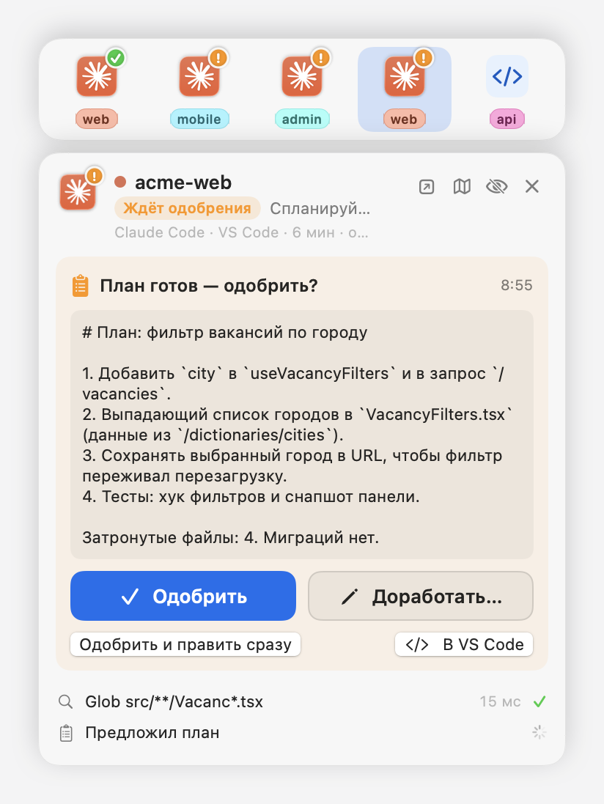
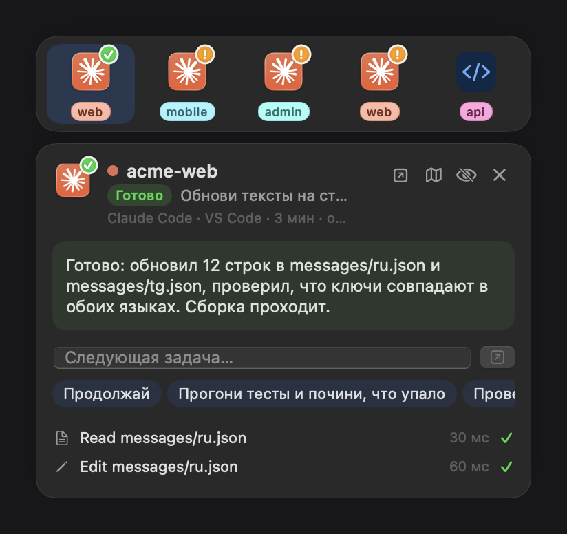
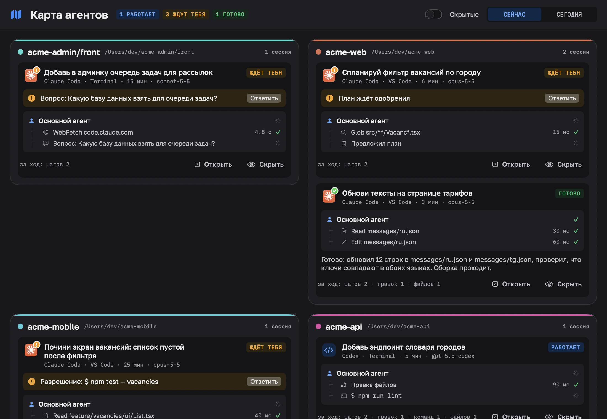
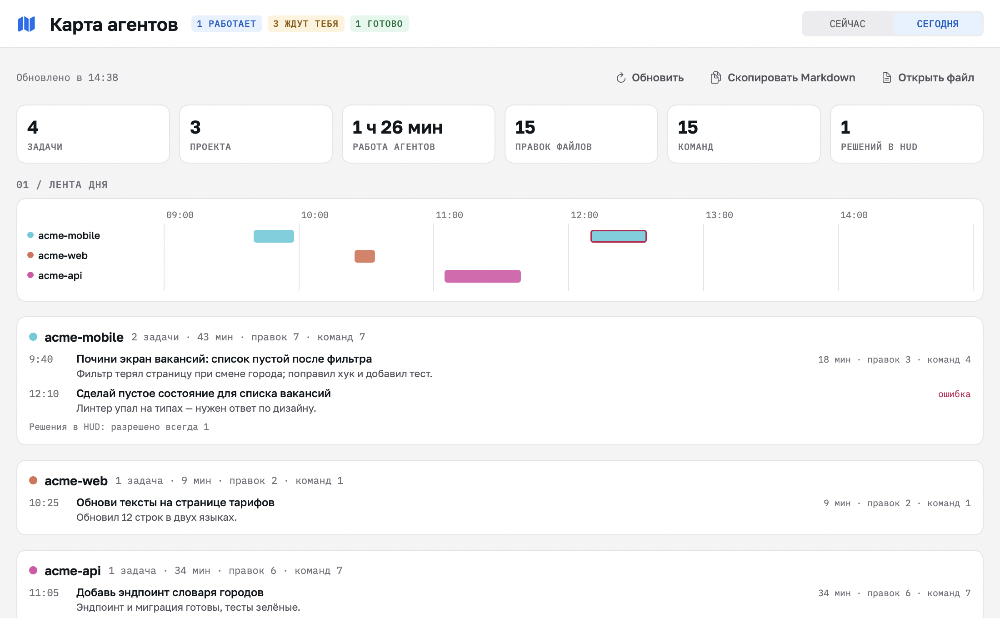
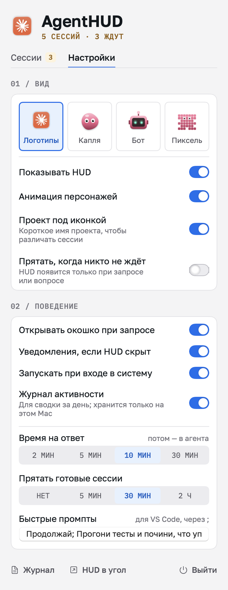

<h1 align="center">AgentHUD</h1>

<p align="center">
  Маленький HUD в углу экрана для ИИ-агентов на macOS.<br>
  Видно, что делает каждая сессия Claude Code (в VS Code, терминале и приложении Claude) и Codex.<br>
  Разрешить действие, одобрить план или ответить на вопрос можно, не переключаясь в редактор.
</p>

<p align="center">
  
</p>

> Форк [vladilenm/agent-hud](https://github.com/vladilenm/agent-hud) (v0.1.1). Что изменено в форке — [ниже](#что-нового-в-форке) и в [docs/DECISIONS.md](docs/DECISIONS.md#форк-020).

## Зачем

Когда агентов несколько, а окна свёрнуты, непонятно, кто из них работает, кто ждёт разрешения, кто задал вопрос, а кто давно закончил. Приходится весь день переключаться между окнами VS Code и вкладками.

AgentHUD висит в правом верхнем углу. У каждой сессии своя иконка и метка проекта, и по ним сразу понятно, что происходит:

| Иконка | Что значит |
|---|---|
| покачивается | агент работает |
| подпрыгивает пару секунд, потом горит оранжевый «!» | ждёт разрешения, ответа или одобрения плана |
| зелёная галочка | закончил, в окошке его итоговое сообщение |
| часы | ты не ответил вовремя, вопрос ушёл в агента |
| бледная | ждёт новую задачу |

## Что умеет

- **Видит Claude Code везде:** панель чата в VS Code, терминал (Terminal, iTerm, встроенный терминал VS Code, herdr), приложение Claude. И Codex — в терминале и в своём приложении.
- **Различает проекты.** Под иконкой — короткая метка проекта с цветом: `mobile`, `web`, `platform`. Общий префикс вроде `acme-` отбрасывается сам.
- **Показывает шаги.** Клик по иконке открывает окошко: проект, твой промпт, лента действий агента («Read src/app.ts», «$ npm test», «Edit …») с длительностью, субагенты — с отступом.
- **Разрешает и отклоняет** действие прямо из окошка — крупными кнопками «Разрешить» и «Отклонить». Отклонить можно с причиной. Разрешить — ⌘↩. Огромный ввод (длинный скрипт, большой файл) прокручивается в окошке, кнопки всегда на виду.
- **«Всегда».** Разрешить и больше не спрашивать: шаблоном (`Bash(npm run *)`) в этом проекте или во всех, либо так, как предлагает сам Claude Code. Правило записывается в настройки Claude Code.
- **Одобряет план.** Когда агент выходит из режима планирования, план показывается в окошке: «Одобрить», «Одобрить и править сразу» (правки без вопросов до конца сессии) или «Доработать…» с замечаниями.
- **Отвечает на вопросы агента:** варианты (цифры 1–9), несколько вариантов, свой ответ.
- **Переходит в сессию** одной кнопкой: нужное окно VS Code и сама сессия Claude в нём, вкладка терминала, тред Codex или сессия в приложении Claude.
- **Следующая задача.** Для сессий в VS Code — поле и быстрые промпты («Продолжай», «Прогони тесты…»): откроется чат сессии с этим текстом в поле ввода, отправляешь сам.
- **Карта агентов.** Отдельное окно: все сессии по проектам, у каждой — дерево «основной агент → субагенты → их шаги», что ждёт тебя и кнопка «Ответить». Вкладка «Сегодня» — лента дня по часам и итоги.
- **Сводка за день** для стендапа: задачи по проектам, итоги, правки и команды — Markdown одним кликом или командой `AgentHUD --summary`.
- **Не мешает.** Не крадёт фокус и не мельтешит: иконки стоят на своих местах, окно меняет размер один раз, а не на каждом кадре анимации. Почти не тратит процессор (≈1% при трёх работающих агентах, 0% в покое). Если AgentHUD не запущен, агенты работают как обычно.
- **Перетаскивается к любому краю.** У левого края окошко раскрывается вправо, у правого — влево; HUD не уходит за край экрана и не залезает на строку меню.

<p align="center">
  
  &nbsp;
  
</p>

<p align="center">
  
</p>

<p align="center">
  
</p>

## Установка

Нужны macOS 15+ на Apple Silicon. Хватит Command Line Tools или Xcode.

```bash
git clone https://github.com/jabborovilyos29/agent-hud.git && cd agent-hud && scripts/build-app.sh --install && open ~/Applications/AgentHUD.app
```

Сборка не подписана Apple: она для себя и подписывается локально (ad-hoc). Чтобы раздать коллегам без `xattr -dr com.apple.quarantine`, нужна подпись и нотаризация через аккаунт Apple Developer.

## Настройка

**1. Подключи Claude Code.** При первом запуске AgentHUD предложит подключиться. Он покажет, что именно добавит в `~/.claude/settings.json`, и сделает копию файла перед записью. Твои хуки и правила останутся как есть. Подключить можно и позже — в панели или командой:

```bash
~/Applications/AgentHUD.app/Contents/MacOS/AgentHUD --connect all
```

`all` подключает только агентов, которые есть на машине: без Codex файл `~/.codex/hooks.json` не создаётся.

**2. Codex (если есть): подтверди хуки.** Codex не запускает новые хуки без проверки: в приложении Codex через «Review hooks» или Settings → Hooks, в терминале — командой `/hooks`.

**3. Готово.** Запусти агента, и он появится в углу экрана. Уже открытые сессии подхватят хуки сами.

Остальное — в панели в строке меню (иконка из шестиугольников):

<p align="center">
  
</p>

- **«Сессии»:** «Карта агентов», «Сводка за день», все сессии со статусами, подключение агентов.
- **«Настройки»:**
  - вид: иконки агентов или персонажи «Капля», «Бот», «Пиксель»; метка проекта под иконкой;
  - время на ответ; автоскрытие готовых сессий; режим «прятать, когда никто не ждёт»;
  - уведомления; автозапуск; журнал активности;
  - быстрые промпты для VS Code (через `;`).

## Как это работает

```
Claude Code / Codex  ──хук──▶  agenthud-hook  ──unix-сокет──▶  AgentHUD.app
 (VS Code, терминал,             (CLI, ~3 мс)                  (HUD, панель, карта)
  приложение)
            ◀── разрешить / отклонить / ответ / план ─────────────┘
```

1. Claude Code и Codex умеют вызывать **хуки** — внешние команды на каждое событие: старт сессии, промпт, вызов инструмента, запрос разрешения, конец ответа.
2. AgentHUD регистрирует свой маленький CLI `agenthud-hook`. Он передаёт событие приложению через локальный unix-сокет (доступен только тебе) и сразу выходит.
3. На запрос разрешения, план или вопрос хук ждёт твоего решения в HUD и возвращает его агенту в формате из [документации хуков](https://code.claude.com/docs/en/hooks): `decision.behavior`, `updatedPermissions` для «Всегда» и режима после плана, `updatedInput` для плана и ответов.
4. Если не ответил вовремя, нажал «В VS Code» / «В терминале» или AgentHUD не запущен, хук тихо выходит, и агент спрашивает у себя как обычно.
5. «Открыть» для VS Code: AgentHUD находит окно с папкой проекта (по `~/.claude/ide/*.lock`, читает только `workspaceFolders` и `pid`), поднимает его и открывает сессию ссылкой `vscode://anthropic.claude-code/open?session=<id>`.

Что ещё важно:
- **Только твои сессии.** HUD показывает сессии, за которыми сидит человек. SDK, `claude -p`, `codex exec` из скриптов и служебные запросы приложений идут мимо: их ничто не подвесит.
- **Всё локально.** Никаких сетевых запросов и телеметрии. Решения пишутся в `~/Library/Application Support/AgentHUD/decisions.log`, журнал активности (промпты, итоги ходов, счётчики) — в `…/AgentHUD/activity/ГГГГ-ММ-ДД.jsonl`. Журнал активности выключается в настройках.

## Ограничения

- **VS Code, вопрос агента.** Пока HUD держит вопрос (`AskUserQuestion`), в чате VS Code его не видно. Кнопка «В VS Code» отпускает вопрос туда.
- **Одобрение плана.** Сделано по документации хуков; приходит ли запрос `ExitPlanMode` в хук во всех режимах и как Claude применяет режим после одобрения — помечено к живой проверке в [DECISIONS.md](docs/DECISIONS.md#форк-020).
- **Другие редакторы.** Cursor и прочие форки VS Code не поддерживаются: их сессии идут мимо HUD.
- **Codex.** У Codex нет хука для вопросов агента и правил «разрешать всегда»: «Всегда» для Codex не показывается. Если в Codex включён авто-ревью (`approvals_reviewer = auto_review`), запросы решает его ревьюер; HUD показывает их спокойно, без «!».
- **Режим без запросов.** Если агент работает без запросов разрешения (`auto` у Claude, `approval_policy = "never"` у Codex), запросов в HUD не будет. Останутся статусы, шаги, вопросы и карта.
- **Сборка.** Пока только Apple Silicon, и сборка не подписана.

## Удаление

1. Выключи автозапуск и отключи агентов в панели или командами:

   ```bash
   ~/Applications/AgentHUD.app/Contents/MacOS/AgentHUD --login-item off
   ```

   ```bash
   ~/Applications/AgentHUD.app/Contents/MacOS/AgentHUD --disconnect all
   ```

2. Удали приложение, хук и данные:

   ```bash
   rm -rf ~/Applications/AgentHUD.app ~/.local/bin/agenthud-hook "$HOME/Library/Application Support/AgentHUD"
   ```

## Разработка

```
Sources/AgentHUDCore/    модель, протокол, хранилище сессий, адаптеры Claude Code и Codex,
                         правила «Всегда», имена проектов, журнал активности и сводка (без UI)
Sources/agenthud-hook/   CLI, который вызывают агенты
Sources/AgentHUD/        приложение: сокет-сервер, HUD, панель, карта агентов, переход в сессию
Tests/                   тесты и реальные события агентов в Fixtures/
docs/                    спецификация, журнал решений, картинки
```

Тесты (работают и с Command Line Tools, и с Xcode):

```bash
swift run agenthud-tests
```

```bash
python3 scripts/integration_test.py
```

```bash
.build/debug/AgentHUD --selftest Tests/AgentHUDCoreTests/Fixtures/claude
```

```bash
.build/debug/AgentHUD --uitest
```

Посмотреть HUD и карту без настоящих агентов:

```bash
AGENTHUD_SOCKET=$PWD/.build/demo.sock .build/debug/AgentHUD --demo --map
```

Картинки для README: `.build/debug/AgentHUD --render-readme docs/images`. Сводка за день в терминал: `AgentHUD --summary` или `AgentHUD --summary 2026-11-20`.

Новый агент подключается отдельным адаптером: реализация `AgentAdapter`, без изменений в интерфейсе. Как устроено всё остальное и почему, — в [docs/SPEC.md](docs/SPEC.md) и [docs/DECISIONS.md](docs/DECISIONS.md).

## Лицензия

[MIT](LICENSE). Оригинал — © Владилен Минин, [vladilenm/agent-hud](https://github.com/vladilenm/agent-hud).

Шрифты Golos Text и IBM Plex Mono распространяются по SIL Open Font License (`Resources/Fonts`). Иконки Claude и Codex принадлежат их правообладателям: AgentHUD не хранит их у себя, а берёт из установленных приложений.
