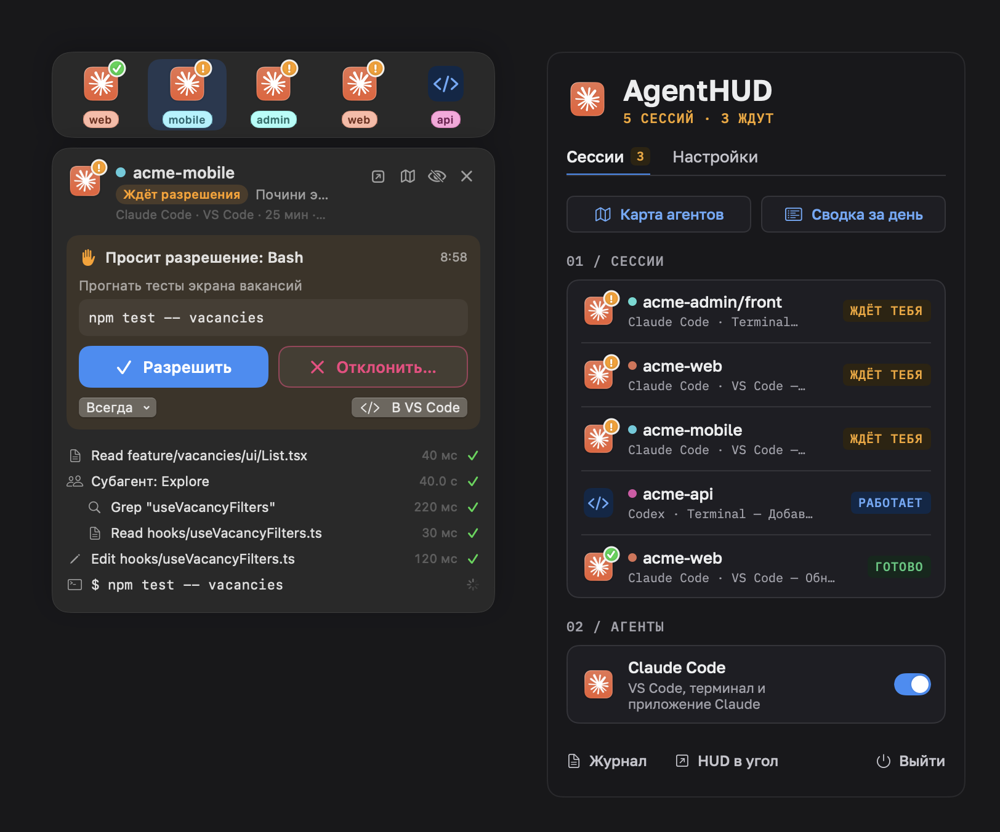
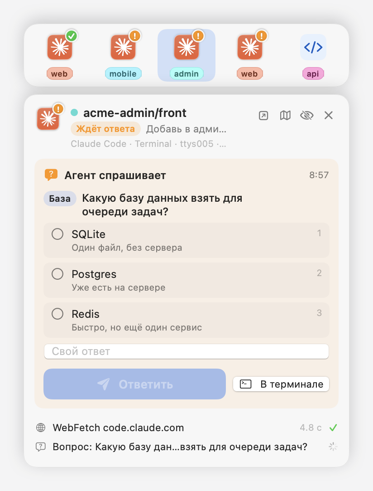

<h1 align="center">AgentHUD</h1>

<p align="center">
  Маленький HUD в углу экрана для ИИ-агентов на macOS.<br>
  Видно, что делает каждая сессия Claude Code и Codex. Разрешить действие или ответить на вопрос можно, не переключаясь в терминал или приложение.
</p>

<p align="center">
  
</p>

## Зачем

Когда агентов несколько, а окна свёрнуты, непонятно, кто из них работает, кто ждёт разрешения, кто задал вопрос, а кто давно закончил. Приходится весь день переключаться между вкладками.

По умолчанию AgentHUD висит в правом верхнем углу основного экрана. У каждой сессии своя иконка агента, и по ней сразу понятно, что происходит:

| Иконка | Что значит |
|---|---|
| покачивается | агент работает |
| подпрыгивает, оранжевый «!» | ждёт разрешения или ответа |
| зелёная галочка | закончил, в окошке его итоговое сообщение |
| часы | ты не ответил вовремя, вопрос ушёл в агента |
| бледная | ждёт новую задачу |

## Что умеет

- **Видит Claude Code и Codex.** И в терминале (Terminal, iTerm, herdr), и в десктопных приложениях Claude и Codex.
- **Показывает шаги.** Клик по иконке открывает окошко: проект, твой промпт, лента действий агента («Read src/app.ts», «$ npm test», «Edit …») с длительностью.
- **Разрешает и отклоняет** действие прямо из окошка. Можно отклонить с причиной, агент её получит. Разрешить — ⌘↩.
- **Отвечает на вопросы агента:** варианты (цифры 1–9), несколько вариантов, свой ответ.
- **Переходит в сессию** одной кнопкой: нужная вкладка терминала, тред Codex или сессия в приложении Claude.
- **Не мешает.** Не крадёт фокус, почти не тратит процессор (≈1% при трёх работающих агентах, 0% в покое). Если AgentHUD не запущен, агенты работают как обычно.

<p align="center">
  
  &nbsp;
  
</p>

## Установка

Нужны macOS 15+ на Apple Silicon.

### Готовая сборка

1. Скачай `AgentHUD.zip` со страницы [Releases](https://github.com/vladilenm/agent-hud/releases) и распакуй в `~/Applications`.
2. Сборка не подписана Apple, поэтому один раз сними карантин:

   ```bash
   xattr -dr com.apple.quarantine ~/Applications/AgentHUD.app
   ```

3. Запусти:

   ```bash
   open ~/Applications/AgentHUD.app
   ```

### Из исходников

Хватит Command Line Tools, Xcode не нужен.

```bash
git clone https://github.com/vladilenm/agent-hud.git && cd agent-hud && scripts/build-app.sh --install && open ~/Applications/AgentHUD.app
```

## Настройка

**1. Подключи агентов.** При первом запуске AgentHUD предложит подключиться к Claude Code и Codex. Он покажет, что именно добавит в `~/.claude/settings.json` и `~/.codex/hooks.json`, и сделает копию каждого файла перед записью. Твои хуки останутся как есть. Подключить можно и позже — в панели или командой:

```bash
~/Applications/AgentHUD.app/Contents/MacOS/AgentHUD --connect all
```

**2. Codex: подтверди хуки.** Codex не запускает новые хуки без проверки. Сделай это один раз: в приложении Codex через «Review hooks» или Settings → Hooks, в терминале — командой `/hooks`.

**3. Готово.** Запусти агента, и он появится в углу экрана.

Остальное — в панели в строке меню (иконка из шестиугольников):

<p align="center">
  
</p>

- **«Сессии»:** все сессии со статусами и подключение агентов.
- **«Настройки»:**
  - вид: иконки агентов или персонажи «Капля», «Бот», «Пиксель»;
  - расположение HUD: экран и угол. Если монитор отключить, HUD переедет на основной и вернётся при подключении;
  - время на ответ;
  - автоскрытие готовых сессий;
  - режим «прятать, когда никто не ждёт»;
  - уведомления;
  - автозапуск при входе в систему.

Окно меню-бара открывается ниже строки меню того экрана, на котором нажали значок AgentHUD. Потяните за ручку в его шапке, чтобы переместить окно. Позиция запоминается отдельно для каждого экрана. Кнопка «Вернуть окно под значок» сбрасывает позицию.

## Как это работает

```
Claude Code / Codex  ──хук──▶  agenthud-hook  ──unix-сокет──▶  AgentHUD.app
 (терминал или приложение)       (CLI, ~3 мс)                  (HUD + панель)
            ◀── разрешить / отклонить / ответ ────────────────────┘
```

1. Claude Code и Codex умеют вызывать **хуки** — внешние команды на каждое событие: старт сессии, промпт, вызов инструмента, запрос разрешения, конец ответа.
2. AgentHUD регистрирует свой маленький CLI `agenthud-hook`. Он передаёт событие приложению через локальный unix-сокет (доступен только тебе) и сразу выходит.
3. На запрос разрешения или вопрос хук ждёт твоего решения в HUD и возвращает его агенту в формате, который описан в документации агента.
4. Если не ответил вовремя, нажал «В терминале» / «В приложении» или AgentHUD не запущен, хук тихо выходит, и агент спрашивает у себя как обычно.

Что ещё важно:
- **Только твои сессии.** HUD показывает сессии, за которыми сидит человек. SDK, `claude -p`, `codex exec` из скриптов и служебные запросы приложений идут мимо: их ничто не подвесит.
- **Всё локально.** Никаких сетевых запросов и телеметрии. Каждое твоё решение пишется в журнал `~/Library/Application Support/AgentHUD/decisions.log`.

## Ограничения

- **Вопросы Codex.** У Codex нет хука для вопросов агента. Поэтому HUD показывает, что агент ждёт ответа, но ответить можно только в самом Codex.
- **Авто-ревью Codex.** Если в Codex включён авто-ревью (`approvals_reviewer = auto_review`), запросы разрешения решает его встроенный ревьюер. HUD показывает их спокойно, без «!»: ответить можно, но не обязательно.
- **Режим без запросов.** Если агент работает в режиме без запросов разрешения (`auto` у Claude, `approval_policy = "never"` у Codex), запросов в HUD не будет. Останутся статусы, шаги и вопросы.
- **Сборка.** Пока только Apple Silicon, и сборка не подписана.

## Удаление

1. Выключи автозапуск и отключи агентов в панели или командами:

   ```bash
   ~/Applications/AgentHUD.app/Contents/MacOS/AgentHUD --login-item off
   ```

   ```bash
   ~/Applications/AgentHUD.app/Contents/MacOS/AgentHUD --disconnect all
   ```

2. Удали приложение, хук и данные:

   ```bash
   rm -rf ~/Applications/AgentHUD.app ~/.local/bin/agenthud-hook "$HOME/Library/Application Support/AgentHUD"
   ```

## Разработка

```
Sources/AgentHUDCore/    модель, протокол, хранилище сессий, адаптеры Claude Code и Codex (без UI)
Sources/agenthud-hook/   CLI, который вызывают агенты
Sources/AgentHUD/        приложение: сокет-сервер, HUD, панель, переход в сессию
Tests/                   тесты и реальные события агентов в Fixtures/
docs/                    спецификация, журнал решений, картинки
```

Тесты:

```bash
swift run agenthud-tests
```

```bash
python3 scripts/integration_test.py
```

```bash
.build/debug/AgentHUD --selftest Tests/AgentHUDCoreTests/Fixtures/claude
```

```bash
.build/debug/AgentHUD --placement-test
.build/debug/AgentHUD --uitest
```

Посмотреть HUD без настоящих агентов:

```bash
AGENTHUD_SOCKET=$PWD/.build/demo.sock .build/debug/AgentHUD --demo
```

Новый агент подключается отдельным адаптером: реализация `AgentAdapter`, без изменений в интерфейсе. Как устроено всё остальное и почему, — в [docs/SPEC.md](docs/SPEC.md) и [docs/DECISIONS.md](docs/DECISIONS.md).

## Лицензия

[MIT](LICENSE).

Шрифты Golos Text, IBM Plex Mono и Spectral распространяются по SIL Open Font License (`Resources/Fonts`). Иконки Claude и Codex принадлежат их правообладателям: AgentHUD не хранит их у себя, а берёт из установленных приложений.
